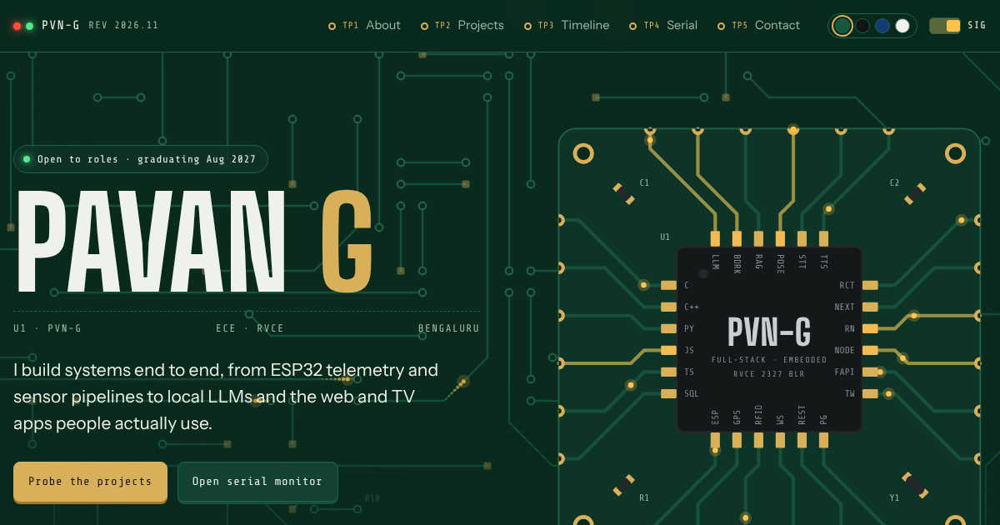

# PVN-G · Pavan G's portfolio

[](https://github.com/Sin-Kid/pvn-g/actions/workflows/ci-cd.yml)
[](https://app.netlify.com/projects/pvn-g/deploys)

**Live:** https://pvn-g.netlify.app

An interactive portfolio built like a circuit board. I'm a final-year Electronics and Communication student at R. V. College of Engineering, Bengaluru, and I build systems end to end, from ESP32 telemetry to local LLMs and the apps on top. The site is meant to feel like that work.



## What's on the board

| Section | What it does |
| --- | --- |
| **U1** | The hero chip. Each of its 24 pins is a core skill; hover one to see which projects drive it. |
| **Schematic** | Every project is an IC wired to the skill nets it uses. Open a chip to energize its nets, or pick a net to trace every chip that depends on it. Unused nets are marked `NC`. |
| **Logic analyzer** | Roles and schools as digital channels, high while active. Drag the cursor (or use the arrow keys) to read what was running at any month. |
| **Serial monitor** | A working console. Try `help`, `net esp32`, `open telebot`, `mask black` or `sudo hire pavan`. |
| **Solder mask** | Switch the board between green, black, blue and white. The animated signals can be turned off, and they stay off for anyone who prefers reduced motion. |

No framework and no build step: plain HTML, CSS and JavaScript, about 100 KB before fonts. The copper field is drawn on a canvas, the chips and wires are SVG, and the fonts are self-hosted.

## Project layout

```
site/                 everything that gets deployed
  index.html          page markup
  404.html            "open circuit" page
  css/                fonts, base tokens and components
  js/                 core (data + event bus), field, u1, schematic, analyzer, serial, ui
  fonts/              Big Shoulders Display, Instrument Sans, Share Tech Mono (OFL)
  _headers            security headers and caching for Netlify
scripts/
  check.mjs           static checks: scripts parse, links resolve, nothing external
  smoke.mjs           opens the site in Chromium and exercises every interactive part
  serve.mjs           local server that applies the same headers as Netlify
.github/workflows/
  ci-cd.yml           checks, then deploys to Netlify
```

## Run it locally

```bash
npm install
npm run serve        # http://localhost:8080
```

## CI/CD

Every push and pull request runs `.github/workflows/ci-cd.yml`:

1. **Validate**: `html-validate` on both pages, a syntax check of every script, broken-reference and third-party checks, and a check that the security headers are still there.
2. **Smoke test**: Playwright opens the site in Chromium with the production Content-Security-Policy and checks that the chips, nets, wires, logic analyzer, serial monitor and mask switch work, with no console errors and no sideways scrolling on a phone.
3. **Deploy**: only if both pass. Pushes to `main` go to production at pvn-g.netlify.app. Pull requests get their own preview URL, shown in the run summary.

Deploys need one repository secret, `NETLIFY_AUTH_TOKEN` (a Netlify personal access token). Without it the checks still run and the deploy step is skipped with a warning.

## Credits

Designed and built by Pavan G. Fonts are used under the SIL Open Font License; see `site/fonts/`.
